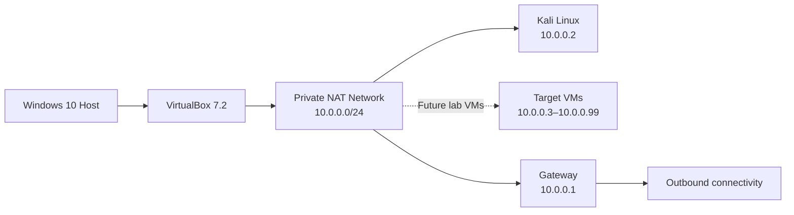

<div align="center">

# Virtual Cybersecurity Laboratory

### VirtualBox · Kali Linux · Isolated NAT Network

[](https://www.virtualbox.org/)
[](https://www.kali.org/)
[](#responsible-use)

*A controlled virtual environment for cybersecurity learning and authorized security testing.*

</div>

---

## Project Overview

This project documents the setup of a virtual cybersecurity and penetration-testing laboratory using **VirtualBox** and **Kali Linux**. The lab provides a controlled environment for practicing network reconnaissance, port scanning, vulnerability assessment, packet analysis, web-security testing, and security-tool experimentation.

The virtual machines are connected to a private **NAT Network**. This allows machines on the same lab network to communicate with one another while maintaining outbound network connectivity. Additional test machines can be added as the lab grows.

## Responsible Use

> **Safety note:** Use this lab only to test systems you own or have explicit permission to assess. Never target unauthorized systems.

## Lab Architecture



## System Configuration

| Component | Configuration |
|---|---|
| Host operating system | Windows 10 |
| Host memory / processor | 8 GB RAM / Intel Core i7 |
| Hypervisor | VirtualBox 7.2 |
| Security operating system | Kali Linux 2026.2 |
| Kali VM memory | 2,048 MB |
| Virtual network | NAT Network (`NatNetwork`) |
| Network range | `10.0.0.0/24` |
| Kali Linux address | `10.0.0.2/24` |
| Default gateway | `10.0.0.1` |
| DNS server | `8.8.8.8` |
| Reserved range for future VMs | `10.0.0.3–10.0.0.99` |

## Setup Summary

1. Install **7-Zip** to extract the Kali virtual-machine package, if required.
2. Install **VirtualBox** and create a dedicated NAT Network named `NatNetwork`.
3. Configure the network with IPv4 prefix `10.0.0.0/24`, DHCP enabled, and IPv6 disabled.
4. Download Kali Linux from the [official Kali website](https://www.kali.org/) and import the VM into VirtualBox.
5. Attach the VM's network adapter to `NatNetwork`; the configured adapter type is Intel PRO/1000 MT Desktop.
6. Set or verify Kali's IP address, subnet mask, gateway, and DNS values using the configuration table above.
7. Optionally configure a shared folder for transferring files between the host and Kali VM.
8. Create a clean VirtualBox snapshot named **Clean Kali – Network Setup** so the VM can be restored to its baseline.

## Verification

Run these checks in Kali Linux to confirm the setup:

| Check | Command | Expected result |
|---|---|---|
| Confirm IP configuration | `ip a` | Kali shows `10.0.0.2/24` |
| Test the virtual gateway | `ping 10.0.0.1` | Successful replies |
| Test outbound connectivity | `ping 8.8.8.8` | Successful replies |
| Test DNS resolution | `nslookup networkwalks.com` | The domain resolves |
| Confirm Nmap is installed | `nmap --version` | Nmap version is displayed |
| Confirm snapshot recovery | Restore the snapshot, then run `ip a` | Baseline settings return |

## Troubleshooting Notes

### Internet access after assigning a static IP

Connectivity may fail depending on the Kali and NetworkManager configuration. One workaround used in this lab was:

```bash
sudo nmcli connection modify "Wired connection 1" ipv4.dad-timeout 0
```

Restart the connection and test connectivity again. The connection name may differ on your system, so identify the correct name before running the command.

### Virtualization is disabled

If the VM will not start because hardware virtualization is unavailable, restart the computer, open the BIOS/UEFI settings, enable **Intel VT-x / hardware virtualization**, save the changes, and start the VM again.

## What I Learned

- A **NAT Network** allows multiple connected VMs to communicate with one another while providing outbound connectivity.
- Virtual machine adapter settings determine how VMs connect and communicate.
- Reliable lab documentation includes the IP address, subnet mask, gateway, and DNS configuration.
- A clean snapshot provides a dependable recovery point before risky or experimental exercises.

## Adding Screenshots to This README

1. In the repository, create a folder named `images`.
2. Save your screenshots in that folder using short, descriptive names, for example `virtualbox-nat-network.png` or `kali-ip-configuration.png`.
3. Add an image line where you want the screenshot to appear in the README. For example:

```markdown

```

You can place it **between paragraphs or directly under a heading**. For example:

```markdown
### NAT Network Configuration

The lab uses a private NAT Network with the `10.0.0.0/24` address range.


The screenshot above shows the network configuration in VirtualBox.
```

For a screenshot hosted elsewhere, use its direct image URL instead of the relative path. Keep image filenames simple, avoid spaces, and include useful alternative text inside the square brackets. GitHub will display the image once both the README and image file are committed to the repository.

<!-- Example image locations (add the files to the repository before enabling these):


-->

---

<div align="center">

**Built for learning. Used responsibly.**

</div>
